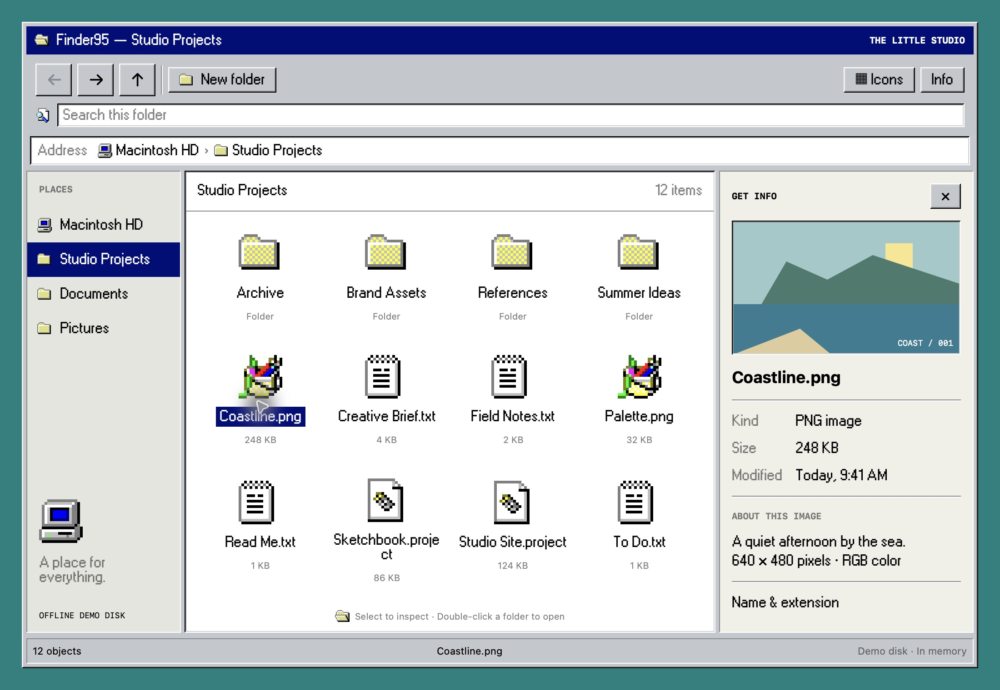
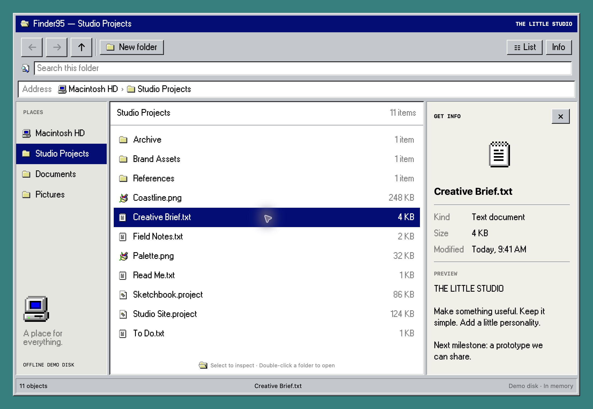
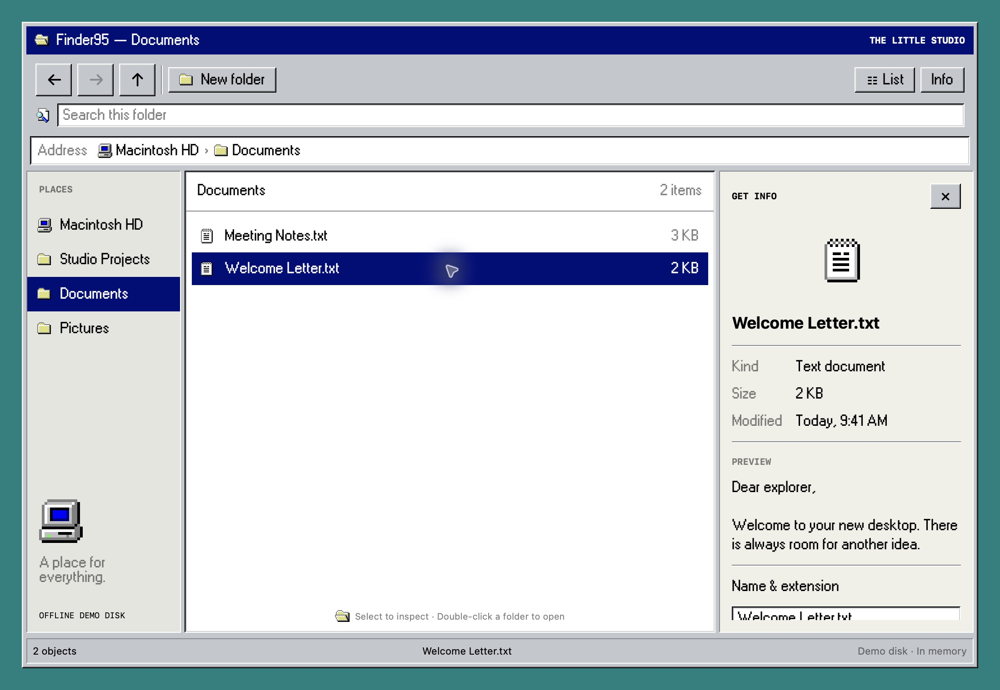

# Finder ’95

A desktop file browser built with Swift95, with a sidebar, breadcrumb navigation and a file inspector.

| Icon view | List view | Documents |
| --- | --- | --- |
| [](../../Website/public/images/examples/finder95.jpg) | [](Screenshots/list.jpg) | [](Screenshots/folder.jpg) |

Browse folders, switch between icon and list layouts, search, create folders, rename items and inspect file previews. The demo disk lives in memory; the app does not read or change your files.

## Run

From the repository root, with Xcode and the Tuist version in `.tool-versions` installed:

```sh
make generate
open Swift95.xcworkspace
```

Choose the **Finder95** scheme and run on Mac, iPhone or iPad. Requires macOS 15 or iOS/iPadOS 18 or later.

## Source

`App/` contains the app entry point and `Features/` contains the UI and local model. Run `make build-examples` to compile all examples for macOS and iOS. Explore interactions manually; the examples have no test targets.

An independent interface study using fictional demo content, unaffiliated with the original product.

[All examples](../README.md) · [Swift95](../../README.md)
