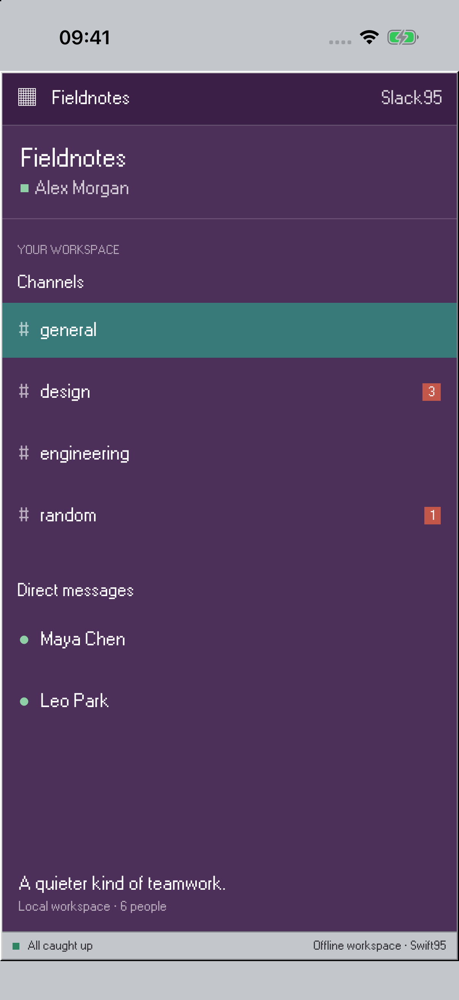
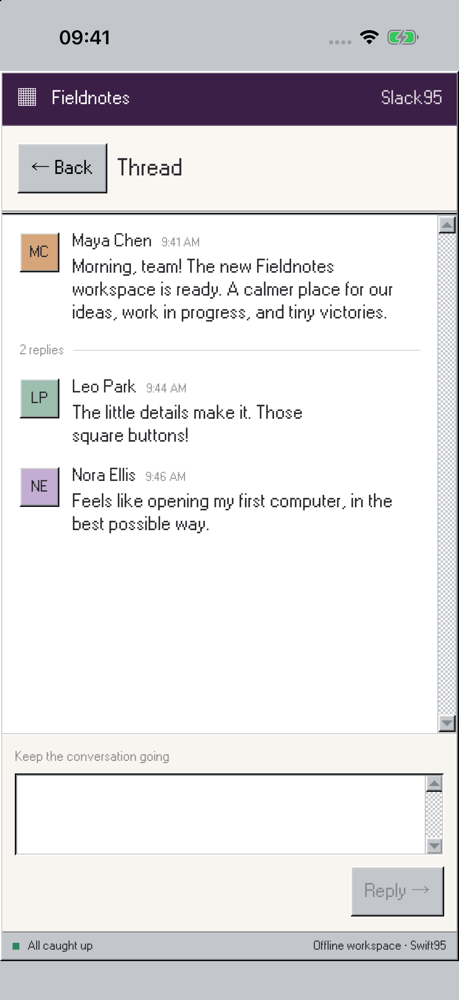

# Slack ’95

A mobile-first team chat built with Swift95. On iPhone, channels, conversations and threads each get a full screen.

| Conversation | Channels | Thread |
| --- | --- | --- |
| [](../../Website/public/images/examples/slack95.png) | [](Screenshots/channels.png) | [](Screenshots/thread.png) |

Switch channels and direct messages, search conversations, send local messages, like posts and reply in threads. Drafts are kept separately for each conversation and thread. All content stays in memory; the app does not connect to Slack.

## Run

From the repository root, with Xcode and the Tuist version in `.tool-versions` installed:

```sh
make generate
open Swift95.xcworkspace
```

Choose the **Slack95** scheme and run on Mac, iPhone or iPad. Requires macOS 15 or iOS/iPadOS 18 or later.

## Source

`App/` contains the app entry point, `Features/` contains the UI and local model, and `Tests/` covers model behavior. Run all example model tests on Mac with `make test-examples-macos`.

An independent interface study using fictional demo content, unaffiliated with the original product.

[All examples](../README.md) · [Swift95](../../README.md)
