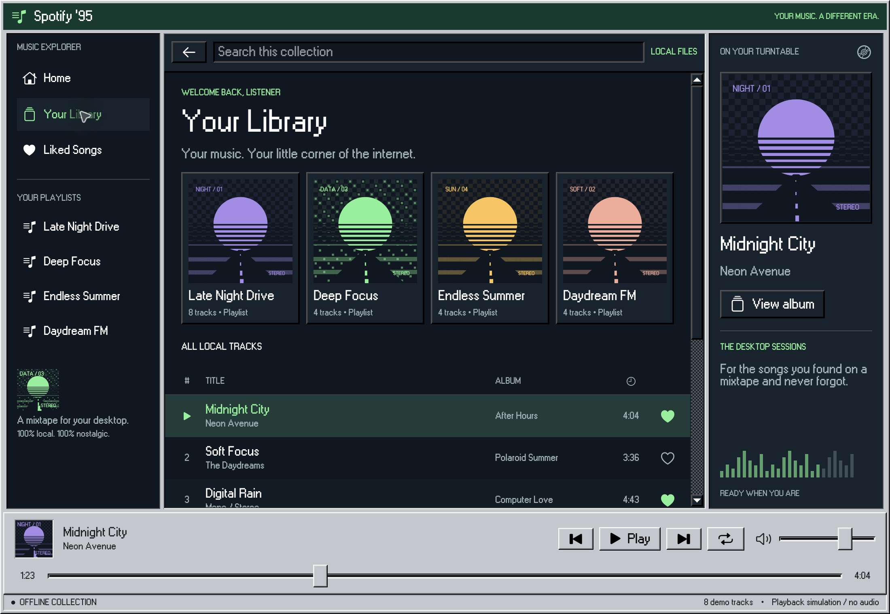
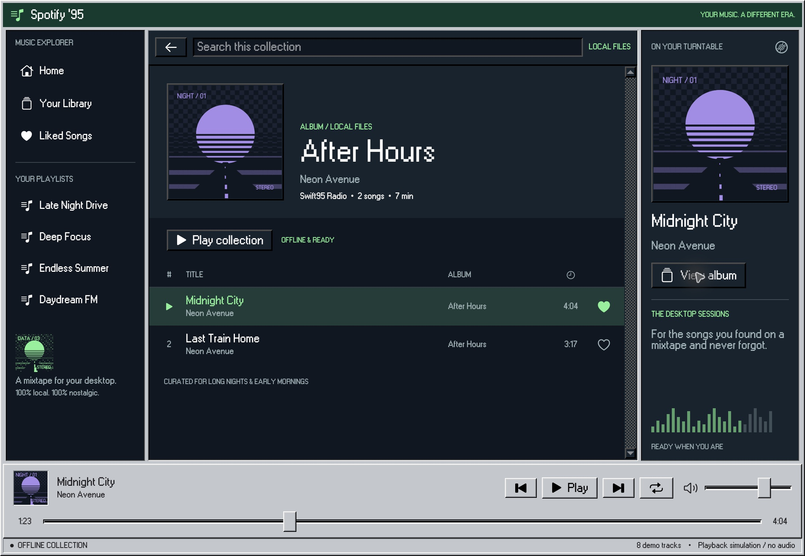

# Spotify ’95

A desktop music library built with Swift95, with playlists, albums, saved tracks and an interactive player.

| Playlist | Library | Album |
| --- | --- | --- |
| [](../../Website/public/images/examples/spotify95.jpg) | [](Screenshots/library.jpg) | [](Screenshots/album.jpg) |

Browse playlists and albums, search tracks, save favorites, and try seeking, volume and repeat controls. Playback is simulated; the app does not play audio or connect to Spotify.

## Run

From the repository root, with Xcode and the Tuist version in `.tool-versions` installed:

```sh
make generate
open Swift95.xcworkspace
```

Choose the **Spotify95** scheme and run on Mac, iPhone or iPad. Requires macOS 15 or iOS/iPadOS 18 or later.

## Source

`App/` contains the app entry point and `Features/` contains the UI and local model. Run `make build-examples` to compile all examples for macOS and iOS. Explore interactions manually; the examples have no test targets.

An independent interface study using fictional demo content, unaffiliated with the original product.

[All examples](../README.md) · [Swift95](../../README.md)
