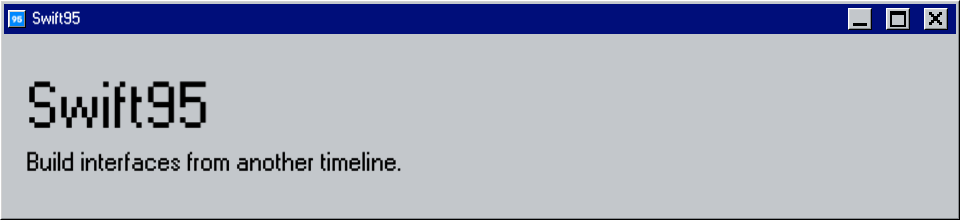

<p align="center">
  
</p>

# Swift95

Swift95 is a Windows 95-inspired component kit for SwiftUI. It brings classic controls,
desktop-style workspaces, themes, and classic icons to native apps without giving up SwiftUI state,
accessibility, or platform behavior.

**[📖 Documentation](https://swift95.dimasike.com)** ·
**[🧩 Components](https://swift95.dimasike.com/components/)** ·
**[🔎 API reference](https://swift95.dimasike.com/api/documentation/)**

## Try it

In Xcode, choose **File → Add Package Dependencies** and enter:

```text
https://github.com/dimamishchenko/swift95
```

Add the `Swift95` product to your target, then use its components like ordinary SwiftUI views:

```swift
import Swift95
import SwiftUI

struct SaveButton: View {
  var body: some View {
    Button95("Save") {
      saveDocument()
    }
  }

  private func saveDocument() {}
}
```

Add the optional `Swift95Icons` product when you want the bundled classic icon set.

Swift95 requires Swift 6 and supports iOS and iPadOS 18 or later and macOS 15 or later.

## Run the catalog

Explore the components locally on Mac, iPhone, or iPad:

```sh
make generate
open Catalog/Swift95Catalog.xcworkspace
```

Run the `Swift95Catalog` scheme for your preferred destination, or
**[🚀 start with the complete guide](https://swift95.dimasike.com/start/)**.

## Development

Use Xcode 26.6 and the Tuist version in `.tool-versions`. Website development also requires
Node.js 22.22 or later and `npm --prefix Website ci`.

```sh
make generate       # Open Catalog/Swift95Catalog.xcworkspace after generation
make format         # Format Swift sources
make check          # Lint, test, and build the Catalog on all platforms
make website-dev    # Preview the website
make website-build  # Build and validate the complete documentation site
```

Run `make help` for individual checks and simulator overrides. CI validates pull requests and
publishes the website after checks pass on `main`.
