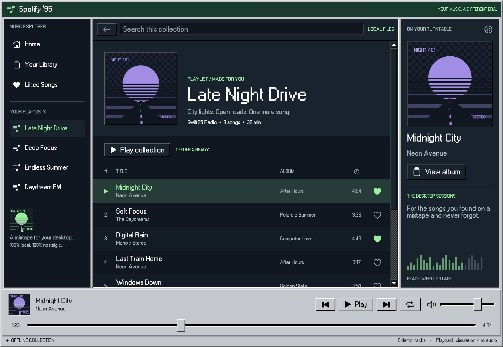
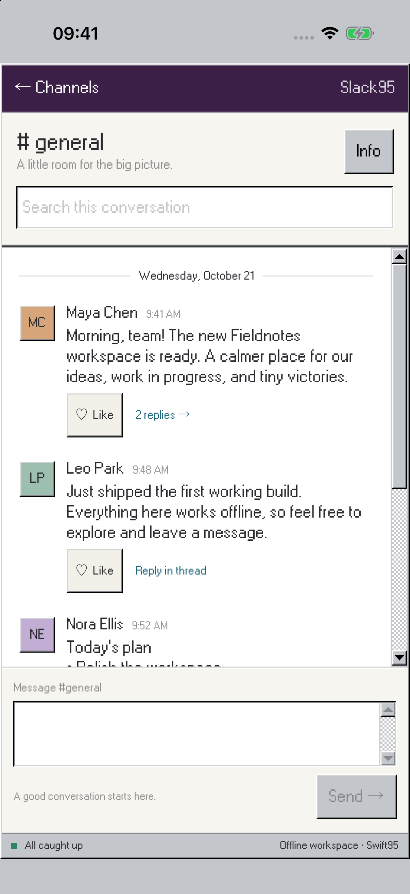

<p align="center">
  
</p>

# Swift95

[](https://github.com/DimaMishchenko/swift95/actions/workflows/tests.yml)

Swift95 is a Windows 95-inspired component kit for SwiftUI. It brings classic controls,
desktop-style workspaces, themes, and classic icons to native apps without giving up SwiftUI state,
accessibility, or platform behavior.

**[📖 Documentation](https://swift95.dimasike.com)** ·
**[🧩 Components](https://swift95.dimasike.com/components/)** ·
**[🔎 API reference](https://swift95.dimasike.com/api/documentation/)**

## Usage

In Xcode, choose **File → Add Package Dependencies** and enter:

```text
https://github.com/dimamishchenko/swift95
```

For a `Package.swift` dependency, use:

```swift
.package(url: "https://github.com/DimaMishchenko/swift95", from: "1.0.0")
```

Add the `Swift95` product to your target, then use its components like ordinary SwiftUI views:

```swift
import Swift95
import SwiftUI

struct SaveButton: View {
  var body: some View {
    Button95("Save") {
      saveDocument()
    }
  }

  private func saveDocument() {}
}
```

Add the optional `Swift95Icons` product when you want the bundled classic icon set.

Swift95 requires Swift 6 and supports iOS and iPadOS 18 or later and macOS 15 or later.

## Examples

| [Spotify ’95](Examples/Spotify95/) | [Slack ’95](Examples/Slack95/) | [Finder ’95](Examples/Finder95/) |
| :---: | :---: | :---: |
| [](Examples/Spotify95/) | [](Examples/Slack95/) | [](Examples/Finder95/) |
| Playlists, albums and a simulated player. | Mobile channels, messages and threads. | Folders, search and file details. |

## Run the catalog

Explore the components locally on Mac, iPhone, or iPad:

```sh
make generate
open Swift95.xcworkspace
```

Run `Swift95Catalog` for the component catalog, or `Spotify95`, `Slack95` and `Finder95` for the
standalone example apps. For setup,
**[🚀 start with the complete guide](https://swift95.dimasike.com/start/)**.

## Development

```sh
make generate       # Open Swift95.xcworkspace after generation
make format         # Format Swift sources
make check          # Lint, test, and build the apps
make website-dev    # Preview the website
make website-build  # Build and validate the complete documentation site
```

Run `make help` for individual checks and simulator overrides. CI skips native tests for
documentation-only changes and publishes the website after checks pass on `main`.

## Inspiration

- [ClassicKit](https://github.com/Baddaboo/ClassicKit)
- [React95](https://github.com/React95/React95)
